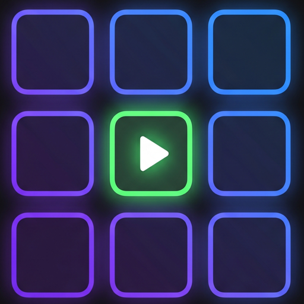

<div align="center">



# MacDeck

**Transforme ton iPhone, ton iPad ou n'importe quel navigateur en Stream Deck pour ton Mac.**<br>
Volume, médias, apps, raccourcis, actions système : tout à portée de doigt.

<br>


</div>

---

## 🧩 L'écosystème

| Dépôt | Contenu | Pour |
|---|---|---|
| **MacDeck** *(ici)* | Serveur Mac, interface web (PWA) et **app iOS à jour** dans [`ios/`](ios) | macOS + tous les clients |
| [MacDeck-iOS](https://github.com/Andre27aj/MacDeck-iOS) | Première version de l'app iOS, en dépôt séparé | iPhone / iPad |
| [MacDeck-Windows](https://github.com/Andre27aj/MacDeck-Windows) | Serveur équivalent pour PC | Windows 10/11 |

## ✨ Ce que tu peux contrôler

<table>
<tr>
<td width="50%" valign="top">

### 🎚️ Son et écran
- **Volume** et **luminosité** avec des sliders précis
- **Mute** du son et du micro, séparément
- Choix de la **sortie audio** (AirPods, enceintes…)
- **Médias** : lecture/pause, piste suivante/précédente, titre en cours

</td>
<td width="50%" valign="top">

### 🚀 Apps et liens
- **Grille d'apps** : lance n'importe quelle app en un tap
- Section **Base** (apps épinglées) et section **En cours** (apps ouvertes ajoutées automatiquement)
- **Boutons URL** : ouvre un site (YouTube…) directement
- Quitter une app à distance

</td>
</tr>
<tr>
<td valign="top">

### ⚙️ Système
Verrouiller · veille · veille écran · capture d'écran · corbeille · Ne pas déranger · mode sombre · Mission Control · Spotlight · Cmd+Tab · Cmd+Q

</td>
<td valign="top">

### 🧠 Intelligent
- **Profils automatiques** : les raccourcis changent selon l'app au premier plan (Figma, Xcode, Safari…)
- **Batterie** du Mac en temps réel
- **Découverte Bonjour** : l'app iOS trouve le Mac toute seule

</td>
</tr>
</table>

## 🚀 Démarrage rapide

```bash
git clone https://github.com/Andre27aj/MacDeck.git
cd MacDeck
npm install
npm start
```

Le terminal affiche l'adresse du Mac, par exemple `MacDeck running → http://192.168.1.42:3000`.

### Se connecter depuis un appareil

<table>
<tr>
<th>🌐 Navigateur / PWA (tout appareil)</th>
<th>📱 App iOS native</th>
</tr>
<tr>
<td valign="top">

1. Ouvre `http://<ip-du-mac>:3000`
2. Clique sur **Jumeler ce Mac**
3. Entre le code à 6 chiffres affiché sur le Mac
4. Optionnel : installe la PWA
   - **iPhone** : Safari → Partager → *Sur l'écran d'accueil*
   - **Android** : Chrome → ⋮ → *Ajouter à l'écran d'accueil*
   - **PC** : icône d'installation dans la barre d'adresse

</td>
<td valign="top">

```bash
brew install xcodegen
cd ios && xcodegen generate
open MacDeck.xcodeproj
```

Choisis ton iPhone, règle ton **Team** dans *Signing & Capabilities* (un compte Apple gratuit suffit), puis lance avec **⌘R**. L'app trouve le Mac via Bonjour et te demande le code de jumelage.

</td>
</tr>
</table>

## 🔐 Sécurité : jumelage par code

Le serveur n'obéit qu'aux appareils jumelés.

1. Le client demande un jumelage, et le Mac affiche un **code à 6 chiffres** dans une fenêtre.
2. Le code expire au bout de **2 minutes**, et 5 essais ratés annulent la tentative.
3. Une fois jumelé, l'appareil reçoit un **token** envoyé dans l'en-tête `X-MacDeck-Token` à chaque requête. Les tokens sont stockés dans `~/.macdeck-tokens` (lisible par toi seul).
4. Les entrées sont nettoyées avant d'arriver dans AppleScript, et les commandes passent par `execFile`, sans shell.

> Pour révoquer tous les appareils, supprime `~/.macdeck-tokens` puis redémarre le serveur.

## 🔑 Permissions macOS

Au premier lancement, macOS demande des autorisations dans *Réglages Système → Confidentialité et sécurité* :

| Fonction | Permission |
|---|---|
| Raccourcis clavier (Spotlight, Mission Control…) | **Accessibilité** → Terminal (ou Node) |
| Contrôle des autres apps | **Automatisation** |
| Capture d'écran | **Enregistrement de l'écran** |

## 📡 API

Toutes les routes sauf `/ping` et `/pair/*` exigent l'en-tête `X-MacDeck-Token`.

<details>
<summary><b>Voir toutes les routes</b></summary>

| Méthode | Route | Description |
|---|---|---|
| GET | `/ping` | Test de connexion |
| POST | `/pair/request` | Affiche un code de jumelage sur le Mac |
| POST | `/pair/confirm` | `{ code }` → `{ token }` |
| GET | `/system/status` | Volume, mute, médias, batterie, app active, apps ouvertes |
| GET / POST | `/volume` | Lire / régler le volume `{ value: 0-100 }` |
| POST | `/mute` | `{ muted: bool }` |
| POST | `/mic/mute` | Bascule le micro |
| POST | `/media/play-pause` · `/media/next` · `/media/prev` | Contrôle média |
| POST | `/launch` | `{ app: "Figma" }` ou `{ app: "https://…" }` |
| POST | `/quit` | `{ app: "Figma" }` |
| GET | `/apps/list` | Apps installées |
| GET | `/apps/running` | Apps ouvertes |
| GET | `/app-icon?name=Figma` | Icône de l'app (PNG) |
| POST | `/shortcut` | `{ keys: ["cmd", "space"] }` |
| GET / POST | `/system/brightness` | Lire / régler la luminosité |
| GET | `/audio/devices` | Sorties audio disponibles |
| POST | `/audio/device` | `{ name: "AirPods" }` |
| POST | `/system/lock` · `/system/sleep` · `/system/sleep-display` | Verrouillage et veille |
| POST | `/system/dark-mode` · `/system/dnd` · `/system/trash` | Mode sombre, Ne pas déranger, corbeille |

</details>

## 🏗️ Comment ça marche

```
iPhone / iPad (SwiftUI)  ─┐
                          ├── HTTP + token ──▶  server.js (Express, port 3000)  ── osascript / pmset / open ──▶  macOS
Navigateur / PWA         ─┘                          │
                                                     └── annonce Bonjour « _macdeck._tcp »
```

Les clients interrogent `/system/status` toutes les 5 secondes pour rester synchronisés.

## 🗂️ Structure

```
MacDeck/
├── server.js        # Serveur Express : toute la logique macOS + jumelage
├── package.json     # express, cors, bonjour-service
├── public/          # PWA : index.html (tout-en-un), manifest, service worker, icônes
└── ios/             # App SwiftUI iPhone/iPad (projet XcodeGen)
```

## ⚠️ Limitations

- Le client et le Mac doivent être sur le **même réseau local** (ou reliés par un VPN).
- L'app iOS s'installe via Xcode : elle n'est pas sur l'App Store.

## 📄 Licence

MIT, voir [LICENSE](LICENSE).
